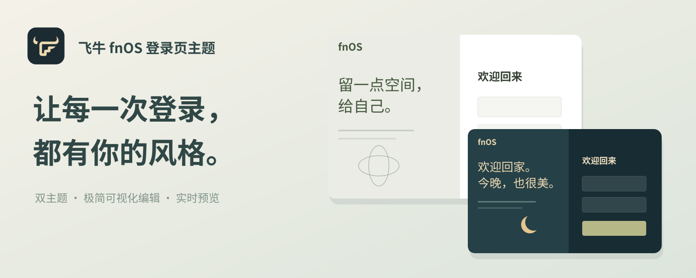

<div align="center">
  
  <h1>飞牛 fnOS 登录页主题</h1>
  <p>Give the fnOS login page a personal look.</p>
  <p>
    <a href="https://github.com/Nyakooo/oh-my-fn-theme/blob/master/LICENSE"></a>
    
    
  </p>
  <p><a href="README.md">简体中文</a> · <a href="README.en.md">English</a></p>
</div>

<p align="center"></p>

## Features

- **Two login themes:** Minimal and Moonlit Home are available for the fnOS login page. Minimal uses a warm white background, a sage split panel, and a dark login button.
- **Browser tab branding:** Customize the tab title and favicon.
- **Explicit site access:** Runs only on fnOS addresses that you add and authorize; it does not scan other sites.
- **Keeps the native sign-in flow:** Changes presentation without replacing the login form or authentication logic.

## Previews

| Login themes | Desktop design example |
| --- | --- |
| [Open login preview](preview.html) | [Open desktop preview](desktop-preview.html) |
| [Open internal desktop preview](internal-preview.html) | Switch between both themes in the desktop preview |

Previews use local sample data and do not connect to a NAS. The desktop preview is a design reference; the extension does not modify the Dock after login.

## Installation

### Load from source (local testing)

1. Download or clone this repository.
2. Open `chrome://extensions` in Chrome or `edge://extensions` in Edge.
3. Enable **Developer mode** and choose **Load unpacked**.
4. Select `dist/oh-my-fn-theme-0.1.12`. If it does not exist yet, run `npm run build` from the repository root first.
5. Open the extension settings, enter the fnOS root URL (for example, `http://192.168.1.20:5666`), review it, and grant access in the browser prompt.
6. Refresh the fnOS page to apply the appearance.

Alternatively, extract `dist/oh-my-fn-theme-0.1.12.zip` and load the extracted directory. The ZIP is an unsigned developer-mode package, not a Chrome Web Store installer.

### URL rules

Use an `http://` or `https://` root URL. A port is allowed, but paths, query strings, fragments, usernames, and passwords are not. Access is scoped to the host and port and covers paths on that origin. Authorize each distinct subdomain, port, or redirect host separately.

## Development

Requires Node.js 20 or later. The extension uses native JavaScript, CSS, and Chromium extension APIs; it has no third-party runtime dependencies.

```sh
npm run build
```

The command reads the version from `manifest.json` and creates:

- `dist/oh-my-fn-theme-<version>/`: unpacked extension directory for Chrome or Edge.
- `dist/oh-my-fn-theme-<version>.zip`: ZIP for local transfer and backup.

The build checks manifest icon references. Run it again after changing extension files. `dist/` is ignored by Git.

## Permissions and privacy

The extension declares `activeTab`, `scripting`, `storage`, and optional HTTP/HTTPS host permissions. It has no NAS site access after installation. A content script is registered only after you add a site in settings and grant access through the browser prompt. Local extension storage contains only confirmed site addresses, appearance preferences, and the favicon you select. The extension does not read passwords, cookies, or network requests, intercept forms, or connect to external services.

Removing a site unregisters its dynamic content script and revokes its host permission. Removing the extension clears its browser-stored extension data.

## Compatibility and limitations

- Chrome and Edge, Manifest V3.
- fnOS DOM structure can change between system versions; verify login panel detection on your device.
- There is no automated browser test suite yet. Before submitting changes, check site authorization, login layout and submission, and theme switching on a target fnOS version.

## Feedback and contributions

Report issues and feature ideas through [GitHub Issues](https://github.com/Nyakooo/oh-my-fn-theme/issues). Include the browser and fnOS versions, page type, and reproduction steps. Do not include passwords, cookies, publicly reachable NAS addresses, or other sensitive information.

For substantial changes, open an issue for discussion first. Pull requests should explain the change and how it was verified, and should build successfully with `npm run build`.

## License

Released under the [MIT License](LICENSE).

## Browser-account sync

Minimal theme copy, colors, layout, visibility and typography sync through the browser's extension sync storage. Use the same browser product and account, enable extension/settings sync, and install the extension with the same extension ID on both devices. Chrome and Edge do not share a sync account. NAS permissions, the theme toggle, tab title and favicon remain local. Browser-managed sync can be delayed or disabled; “submitted to browser sync” does not confirm delivery to another device. Failed uploads keep local edits and retry. Unpacked extensions loaded from different paths may have different IDs; check IDs or use JSON export/import for migration. The extension does not change the existing ID.
